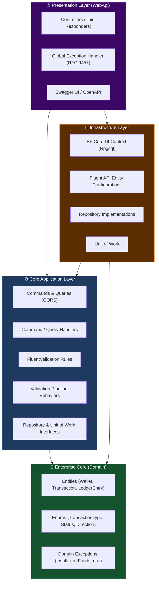
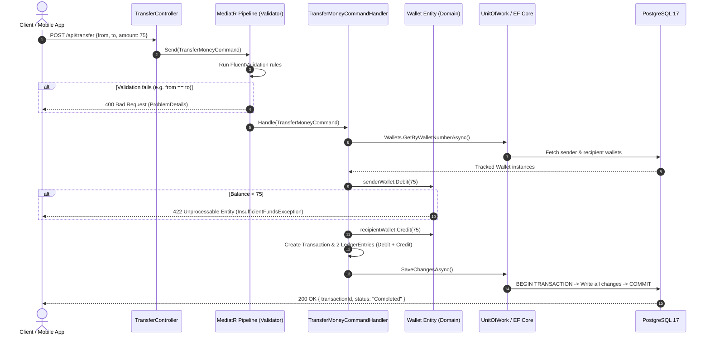

# 💳 DigitalWallet Web API

[](https://dotnet.microsoft.com/)
[](https://www.postgresql.org/)
[](https://www.docker.com/)
[](#-architecture--design-patterns)
[](#-cqrs--mediatr-pipeline)
[](https://opensource.org/licenses/MIT)

An enterprise-grade, high-performance financial transaction engine designed with **Clean Architecture**, **Domain-Driven Design (DDD)** principles, **CQRS**, and **Double-Entry Bookkeeping**. 

This project simulates a real-world fintech backend capable of processing concurrent wallet transactions with strict consistency, auditability, and race condition protection.

---

## 🌟 Key Highlights & Engineering Decisions

* **Double-Entry Bookkeeping Ledger:** Every financial operation generates immutable `LedgerEntry` records (Debit/Credit), guaranteeing that money cannot appear or disappear without a clear audit trail.
* **Race Condition & Double-Spend Protection:** Implements **Optimistic Concurrency Control** via PostgreSQL's system column (`xmin`) mapped as an EF Core shadow property, preventing concurrent overdrafts.
* **Rich Domain Model (No Anemic Entities):** Business invariants and balance manipulation rules are strictly encapsulated inside Domain Entities using Guard Clauses and custom Domain Exceptions.
* **Pre-Execution Pipeline Validation:** Input formats and business rules (e.g., preventing transfer to self, zero/negative amounts) are validated via **FluentValidation** executed inside **MediatR Pipeline Behaviors** before reaching the database or business handlers.
* **RFC 9457 Global Error Handling:** All domain exceptions and validation failures are captured by a custom .NET 8 `IExceptionHandler` and converted into standardized `ProblemDetails` with appropriate HTTP status codes (`400`, `404`, `422`, `500`).
* **Containerized Zero-Config Deployment:** Includes multi-stage `Dockerfile` and `docker-compose.yml` with automated database migrations running on startup.

---

## 🏛 Architecture & Design Patterns

The solution strictly adheres to the dependency inversion rule of **Clean Architecture**: dependencies flow strictly inwards towards the Domain layer.



---

## 🔄 End-to-End Transaction Flow

Here is how a `POST /api/transfer` request is securely executed across all architectural boundaries:



---

## 🛠 Tech Stack & Libraries

| Technology | Purpose |
|---|---|
| **.NET 8 (C# 12)** | Core application platform |
| **ASP.NET Core Web API** | RESTful HTTP API Presentation |
| **PostgreSQL 17** | Relational Database & Concurrency Tracking |
| **Entity Framework Core 8** | ORM, Migration Engine & Change Tracking |
| **Npgsql.EntityFrameworkCore.PostgreSQL** | Native PostgreSQL driver for EF Core |
| **MediatR 14** | In-process mediator implementing CQRS and Pipeline Behaviors |
| **FluentValidation 12** | Strongly-typed validation rules decoupled from Domain |
| **Swagger / Swashbuckle** | Interactive OpenAPI 3.0 Documentation & Exploration |
| **Docker & Docker Compose** | Multi-stage image build and multi-service orchestration |

---

## 🚀 Quick Start (Running the Application)

### Option 1: Run with Docker Compose (Recommended - Zero Configuration)

Ensure you have [Docker Desktop](https://www.docker.com/) installed and running.

```bash
# 1. Clone the repository
git clone https://github.com/your-username/DigitalWallet.git
cd DigitalWallet

# 2. Build and start containers
docker compose up -d --build
```

The database and web service will start. Database migrations will be automatically applied on startup.
Open your browser and navigate to:
👉 **[http://localhost:5235/swagger](http://localhost:5235/swagger)**

To shut down:
```bash
docker compose down
```

---

### Option 2: Run Locally via .NET CLI

1. **Prerequisites:**
   * [.NET 8 SDK](https://dotnet.microsoft.com/download/dotnet/8.0)
   * [PostgreSQL 17](https://www.postgresql.org/download/) running on `localhost:5432`

2. **Configure Database Connection:**
   Update password in `DigitalWallet.WebApi/appsettings.json`:
   ```json
   "ConnectionStrings": {
     "DigitalWalletDb": "Host=localhost;Database=digitalwallet;Username=postgres;Password=YOUR_PASSWORD"
   }
   ```

3. **Apply Migrations and Run:**
   ```bash
   # Apply EF Core migrations
   dotnet ef database update --project DigitalWallet.Infrastructure --startup-project DigitalWallet.WebApi

   # Run Web API
   dotnet run --project DigitalWallet.WebApi
   ```

4. Navigate to **[http://localhost:5235/swagger](http://localhost:5235/swagger)**.

---

## 📡 API Endpoints

| Method | Endpoint | Description | Request Body / Parameters | Status Codes |
|---|---|---|---|---|
| `POST` | `/api/wallet` | Create a new digital wallet | `{"userId": "guid", "walletNumber": "W001", "currency": "AZN"}` | `201 Created`, `400` |
| `POST` | `/api/wallet/deposit` | Deposit money into wallet | `{"walletNumber": "W001", "amount": 200.00}` | `200 OK`, `400`, `404` |
| `POST` | `/api/wallet/withdraw` | Withdraw money from wallet | `{"walletNumber": "W001", "amount": 50.00}` | `200 OK`, `400`, `404`, `422` |
| `GET` | `/api/wallet/{walletNumber}/balance` | Query current wallet balance | Route: `walletNumber` | `200 OK`, `404` |
| `GET` | `/api/wallet/{walletNumber}/transactions` | Query wallet transaction history (statement) | Route: `walletNumber` | `200 OK`, `404` |
| `GET` | `/api/wallet/{walletNumber}/summary` | Query financial summary (inflow, outflow, count) | Route: `walletNumber` | `200 OK`, `404` |
| `GET` | `/api/wallet/{walletNumber}/reconcile` | Mathematical balance audit via historic ledger entries | Route: `walletNumber` | `200 OK`, `404` |
| `POST` | `/api/transfer` | Transfer funds between two wallets | `{"fromWalletNumber": "W001", "toWalletNumber": "W002", "amount": 75.00}` | `200 OK`, `400`, `404`, `422` |

---

## 📂 Project Structure

```text
DigitalWallet/
├── DigitalWallet.sln
├── Dockerfile                             # Multi-stage production build definition
├── docker-compose.yml                     # Multi-service container orchestration
├── .dockerignore
│
├── DigitalWallet.Domain/                  # Enterprise Business Core (Zero dependencies)
│   ├── Entities/                          # Wallet, Transaction, LedgerEntry
│   ├── Enums/                             # TransactionType, TransactionStatus, LedgerDirection
│   └── Exceptions/                        # InsufficientFundsException, DomainException, etc.
│
├── DigitalWallet.Application/             # Use Cases & Orchestration
│   ├── Common/
│   │   ├── Behaviors/                     # ValidationBehavior (MediatR Pipeline)
│   │   └── Models/                        # Result DTOs (TransferResultDto, BalanceDto, etc.)
│   ├── Features/                          # Vertical slice command & query handlers
│   │   ├── CreateWallet/
│   │   ├── Deposit/
│   │   ├── GetBalance/
│   │   ├── GetTransactions/
│   │   ├── GetWalletSummary/
│   │   ├── ReconcileWallet/
│   │   ├── Transfer/
│   │   └── WithDraw/
│   └── Interfaces/                        # IUnitOfWork, IWalletRepository, etc.
│
├── DigitalWallet.Infrastructure/          # External Concerns & Persistence
│   ├── Persistence/
│   │   ├── Configurations/                # Fluent API mappings & shadow properties (xmin)
│   │   ├── Migrations/                    # EF Core schema migration history
│   │   ├── Repositories/                  # WalletRepository, UnitOfWork implementation
│   │   └── DigitalWalletDbContext.cs      # Change tracker & database session
│   └── DependencyInjection.cs
│
└── DigitalWallet.WebApi/                  # Entry Point & HTTP Endpoints
    ├── Controllers/                       # WalletController, TransferController
    ├── Middleware/                        # GlobalExceptionHandler (RFC 9457 ProblemDetails)
    ├── Program.cs                         # Composition root & auto-migration trigger
    └── appsettings.json
```

---

## 🛡️ Enterprise Engineering Decisions Explained

### 1. Why Double-Entry Bookkeeping?
Directly updating a wallet balance (`UPDATE Wallets SET Balance = Balance + 100`) without an audit ledger is catastrophic in fintech. In this project, every transaction creates balancing `LedgerEntry` records. The wallet balance can be mathematically verified at any time by summing its historic ledger entries.

### 2. Why Shadow Property (`xmin`) for Concurrency?
To handle high-concurrency race conditions (e.g., simultaneous withdrawals from ATM and mobile app), we leverage PostgreSQL's native `xmin` transaction identifier as an EF Core **Shadow Property**. This keeps our Domain layer 100% clean of database-specific timestamp/rowversion types while guaranteeing optimistic locking at the database level.

### 3. Why MediatR Pipeline Behaviors instead of Action Filters?
Validation logic is part of the application boundary, not the presentation boundary. By using `ValidationBehavior<TRequest, TResponse>`, validation automatically runs regardless of whether the request comes from an HTTP Controller, a background worker, or a message queue consumer.

---

## 👨‍💻 Author

Developed with care by **Anvar (Ənvər)**.
* Focused on scalable backend systems, Clean Architecture, and Domain-Driven Design in .NET.
* Open for Junior/Mid Backend Developer opportunities.
